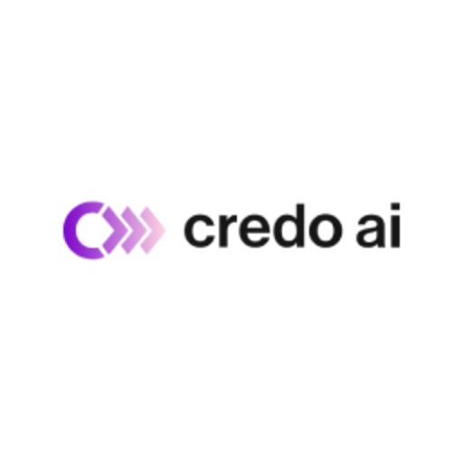
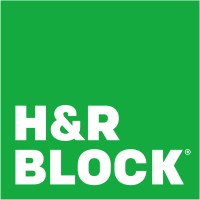

# Remote Product Manager jobs: USA

[All job listings](https://github.com/noah-42/job-listings) · [PM directory](README.md) · [Discovery catalogue](discovery.md) · [CSV](data/jobs.csv) · [JSON](data/jobs.json)

21 listings. Remote and remote-first; routine hybrid excluded. API-only means employer availability has not been rechecked. More matches are being screened. 🇬🇧 English sufficient · 🇩🇪 German required · Unclear: not confirmed.

| Logo&nbsp;&nbsp;&nbsp;&nbsp;&nbsp;&nbsp;&nbsp;&nbsp;&nbsp;&nbsp;&nbsp;&nbsp;&nbsp;&nbsp;&nbsp;&nbsp;&nbsp;&nbsp;&nbsp;&nbsp;&nbsp;&nbsp;&nbsp;&nbsp; | Company | Title | Posted (2026) | Location | Pay range | Language | Requirements |
| :---: | :--- | :--- | :--- | :--- | :--- | :--- | :--- |
|  | [Twin Health](https://usa.twinhealth.com/) | [Principal Product Manager, New Programs](https://sportstechjobs.com/principal-product-manager-new-programs-twin-health/6af52e5e2bf7e191ea99e751) | Nov-12 | USA; existing US work authorization; no sponsorship; API-only | API USD 160,000 - 235,000; description USD 205,000 - 235,000 / year; source conflict | Unclear | 7+ years PM; consumer products; 0-to-1 and scaling; experimentation; mobile/AI collaboration |
|  | [Liftoff](https://liftoff.ai/) | [Senior Staff Product Manager, eCommerce, Remote Job](https://dynamitejobs.com/company/liftoff/remote-job/senior-staff-product-manager-ecommerce-2) | Nov-12 | 18 US states (see sources); Pacific preferred; quarterly gatherings; API-only | USD 198,000 - 280,000 / year; 3 location bands (sources) | Unclear | 8+ years PM; performance advertising; ident ity/attribution; ML campaign optimization; cross-functional leadership |
| ⛳️ | Veradigm® ⛳️ | [Principal Product Manager - Salesforce CPQ &amp; Agentforce](https://revpath.dealhub.io/jobs/802893677-principal-product-manager-salesforce-cpq-agentforce) | Nov-11 | USA remote; API location North Carolina; work authorization required; API-only | USD 130,241 - 189,502 / year | Unclear | 10+ years PM/business systems; 5+ years quote-to-cash; Salesforce CPQ; degree or equivalent; US/Canada work authorization; no sponsorship |
|  | [Credo AI](https://www.credo.ai/) | [Product Manager, Integrations](https://jobs.ashbyhq.com/credo.ai/d727dd55-8e73-493e-b2c8-dcb366dca88f) | Nov-10 | USA; Pacific preferred; offsites multiple times/year | USD 170,000 - 190,000 / year | Unclear | 5+ years PM; integ ration/developer platforms/APIs; identity/security tooling; partnerships; can read code |
|  | [Coinbase](https://www.coinbase.com/en-de) | [Senior Product Manager, Simple Trading](https://www.coinbase.com/careers/positions/8374607?gh_jid=8374607) | Nov-10 | USA remote; attendance not stated in API | USD 218,025 - 256,500 / year | 🇬🇧 | 5+ years PM; 2+ years trading/fint ech/marketplaces; consumer UI; SQL; experimentation |
|  | [Hard Rock Digital](https://www.hardrockdigital.com/) | [Senior Product Manager - Technical Data, Quantitative Sports](https://www.parlayjobs.com/jobs/senior-product-manager-technical-data-quantitative-sports-863a948c) | Nov-10 | USA remote; API-only | Not stated | 🇬🇧 | 5-8 years PM/technical delivery; sports betting |
|  | [Delinea](https://delinea.com/) | [Senior Product Manager - Non-Human Identity Security](https://jobs.ashbyhq.com/delinea/870e5dea-9a82-4a95-941e-34b5caacde4b) | Nov-09 | Anywhere in USA | USD 145,000 - 162,000 / year | Unclear | 5+ years PM; security/identity infrastructure; machine identities |
|  | [Movable Ink](https://movableink.com/) | [Senior Technical Product Manager, Integrations](https://movableink.com/job-listing?gh_jid=8313321) | Nov-09 | New York (Remote), USA; exact state coverage not listed | USD 145,000 - 185,000 / year | Unclear | 5+ years PM; third-party integrations; engi neering/design; partner relationships |
|  | [Movable Ink](https://movableink.com/) | [Senior Product Manager, Data Interfaces](https://movableink.com/job-listing?gh_jid=8313117) | Nov-09 | New York (Remote), USA; exact state coverage not listed | USD 145,500 - 185,000 / year | Unclear | 5+ years data/platform PM; self-service data transformation and activation |
|  | [Natera](https://www.natera.com/) | [Senior Product Manager, ClinicalAI Real-World Data (RWD)](https://job-boards.greenhouse.io/natera/jobs/6239213004) | Nov-06 | USA remote | Not stated | 🇬🇧 | 5+ years PM; 2+ shipped user-facing products; AI workflows; degree or equivalent |
|  | [Tailscale](https://tailscale.com/) | [Product Manager, Identity](https://job-boards.greenhouse.io/tailscale/jobs/4751755005) | Nov-06 | USA remote | USD 177,000 - 221,000 / year | Unclear | 4-7 years PM; identity platform; OIDC/SAML/SCIM; access control |
|  | [Datavant](https://www.datavant.com/) | [Sr. Product Manager, L&amp;I](https://www.datavant.com/about/careers/open-roles/job?gh_jid=5466392008) | Nov-06 | USA remote; API-only | USD 170,000 - 200,000 / year | 🇬🇧 | 5+ years PM; enterprise data-ce ntricB2BSaaS;API/p latform |
|  | [SandboxAQ](https://www.sandboxaq.com/) | [Principal Technical Product Manager, Data Platform](https://jobs.ashbyhq.com/sandboxaq/622ef111-1333-480b-b63a-90b0b4cc205d) | Nov-06 | USA remote listing; API-only | USD 163,200 - 306,000 / year | Unclear | 5+ years PM; data  platforms/governan ce |
|  | [Vanta Incorporated](https://www.vanta.com/company/about) | [Senior Product Manager, Organizational Units](https://jobs.ashbyhq.com/vanta/82dd0fed-120e-4983-a1ae-676ae355cea8) | Nov-05 | USA remote | USD 207,000 - 244,000 / year | Unclear | 5+ years PM; enterprise B2B/SaaS; permissions and organizational structure |
| ⛳️ | [Splash Financial](https://www.splashfinancial.com/) | [Senior Product Manager](https://job-boards.greenhouse.io/splashfinancial/jobs/4727005006) | Nov-04 | USA only | USD 145,000 - 185,000 / year | Unclear | 6+ years PM; consumer tech/fintech; lending and compliance |
|  | [Higharc](https://www.higharc.com/) | [Sr. Product Manager - Studio Data Platform](https://jobs.ashbyhq.com/Higharc/1a0b4edc-9c38-41e0-8699-6c646682a760) | Aug-07 | Continental USA; API-only | Not stated | Unclear | 5+ years PM; deplo yed/customer-facin g enterprise products |
|  | [Zillow](https://www.zillow.com/) | [Senior Product Manager, Agent CRM](https://zillow.wd5.myworkdayjobs.com/job/Remote-USA/Senior-Product-Manager--Agent-CRM_P751746-2) | Unknown | USA: 50 states with limited exceptions; API-only | USD 151,700 - 242,300 / year | 🇬🇧 | 5+ years PM or equivalent; CRM/agent workflows; product strategy |
|  | [Workiva](https://www.workiva.com/) | [Principal BT Product Manager](https://workiva.wd503.myworkdayjobs.com/job/USA---Remote/Principal-BT-Product-Manager_R12705) | Unknown | USA remote within country of employment; API-only | USD 154,000 - 265,000 / year | Unclear | 10+ years enterpri se/business systems or8+advanceddegree |
|  | [Indeed.com](https://de.indeed.com/?r=us) | [Sr. Product Manager](https://careers-indeed.icims.com/jobs/48181/sr.-product-manager/job) | Unknown | US remote only; API-only | USD 150,000 - 224,000 / year | 🇬🇧 | 12-14 years relevant experience or equivalent educati on/experience |
| ⛳️ | [Chamberlain Group (CG)](https://www.chamberlaingroup.com/) | [Sr. Software Product Manager, myQ (Remote)](https://chamberlain.wd1.myworkdayjobs.com/job/Remote---Pennsylvania/Sr-Software-Product-Manager--myQ--Remote-_JR31881) | Unknown | Pennsylvania,USA remote listing; API-only | USD 150,470 - 252,579 / year | Unclear | 5+ years PM/engine ering/productowner |
|  | [H&amp;R Block](https://www.hrblock.com/) | [Senior Product Manager, Spruce](https://careers-hrblock.icims.com/jobs/79568/senior-product-manager%2c-spruce/job) | Unknown | Missouri,USA remote listing; API-only | USD 101,200 - 161,900 / year | 🇬🇧 | 6+ years PM/related; relevantBachelor; mobileproducts |

Dates are source posting dates (Mon-DD; header gives the year), not scrape dates. Exports retain ISO dates. Not stated means the source gives no usable value. Pay keeps source currency; clear large missing-period ranges are displayed annually under the listing convention. Conflicts remain labeled; raw periods stay in exports. [Source notes](sources.md).
